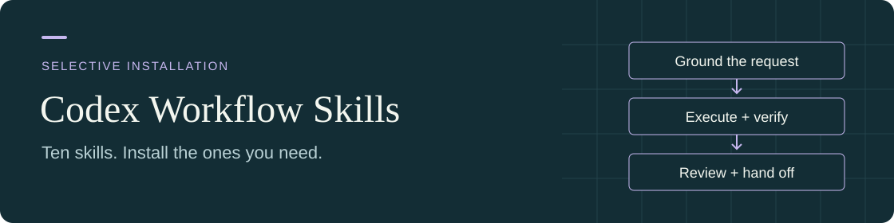

# Codex Workflow Skills

<p align="center">
  
</p>

실제 작업에서 반복되는 판단·실행 문제를 다루는 **10개의 선택 설치형 스킬**입니다. 요청과 기존 기능을 먼저 맞추고, 반복 오류를 근거로 진단하고, 검증된 상태에서 작업을 이어가도록 돕습니다.

Ten focused, independently installable skills for grounded changes, evidence-driven debugging, lean execution, bounded delegation, critical review, recipient-aware context transfer, visual prompt reconstruction, and retrospective skill-use review.

각 폴더의 `SKILL.md`가 핵심 지침입니다. 필요한 스킬만 설치할 수 있습니다. 원문은 한국어와 영어가 혼합되어 있으며, 이미지 프롬프트 복원 스킬은 기본적으로 한국어·영어 프롬프트를 모두 제공합니다.

개발 안내: 이 스킬 모음은 AI가 생성하고 사용자 요구와 사용 피드백으로 개선했습니다. [전체 고지](#ai-개발-고지)를 확인하세요.

[스킬 선택](#스킬-선택) · [설치](#설치) · [사용 예시](#사용) · [의존성과 적용 범위](#의존성과-적용-범위) · [라이선스](LICENSE)

## 스킬 선택

| 스킬 | 해결하는 문제 | 요청 예시 |
|---|---|---|
| [request-grounding](skills/request-grounding/SKILL.md) | 요구·기존 기능·소유 계층이 불명확한데 구현부터 시작함 | “이 기능이 이미 가능한지, 어느 계층을 바꿔야 하는지 불명확해. 확인해줘.” |
| [evidence-driven-debugging](skills/evidence-driven-debugging/SKILL.md) | 첫 수정 후 재발하거나 여러 원인이 혼재함 | “수정 후에도 재발했어. 원인을 판별할 근거를 먼저 찾아줘.” |
| [execute-leanly](skills/execute-leanly/SKILL.md) | 파일 읽기·계획·상태 조회·검증을 반복함 | “현재 승인된 작업에서 반복 조회를 줄이고 오래 걸리는 실행을 안전하게 지켜봐줘.” |
| [swarm](skills/swarm/SKILL.md) | 위임할 수 있는 구현·근거 수집을 메인이 모두 수행함 | “범위가 명확한 구현과 근거 수집을 적합한 작업자에게 맡기고 결과를 검증해줘.” |
| [adversarial-review](skills/adversarial-review/SKILL.md) | 취합한 결론의 숨은 전제와 중요한 반례를 놓침 | “이 계획을 적대적으로 검토하고 유지할지 판단해줘.” |
| [codex-why](skills/codex-why/SKILL.md) | 관행·추론·과거 결정을 필수 규칙처럼 설명함 | “그 승인이 필수라는 판단은 어떤 현재 규칙에서 나왔어?” |
| [pink-elephant-guard](skills/pink-elephant-guard/SKILL.md) | 폐기된 문구나 구조가 확정 산출물·전달 지시문에 다시 등장함 | “필요한 운영 근거는 보존하고, 전달할 확정 문안만 현재안으로 정리해줘.” |
| [prepare-codex-handoff](skills/prepare-codex-handoff/SKILL.md) | 다른 대화·웹 ChatGPT·AI·사람에게 필요한 맥락과 접근 가능한 자료가 빠짐 | “이 작업을 담당하던 대화를 찾아 확정안을 전달해줘.” |
| [visual-prompt-reconstructor](skills/visual-prompt-reconstructor/SKILL.md) | 이미지를 피상적인 스타일 키워드로만 설명함 | “이 참고 이미지를 재현할 한국어·영어 프롬프트를 만들어줘.” |
| [skill-usage-review](skills/skill-usage-review/SKILL.md) | 스킬 읽기를 실제 적용·성공으로 오인하거나 사용 이력의 범위를 놓침 | “마지막 수정 이후 실제 사용 기록을 검토해 유지·수정·통합 여부를 판단해줘.” |

## 설치

### Codex에 요청

`skill-installer`를 사용할 수 있는 환경에서는 원하는 폴더의 GitHub 주소를 지정합니다.

```text
$skill-installer https://github.com/M-T-D-N/codex-workflow-skills/tree/main/skills/adversarial-review
```

다른 스킬을 설치하려면 마지막 폴더 이름을 바꾸세요. 기존에 같은 이름의 스킬이 있으면 내용을 비교하고 유지·교체할 대상을 먼저 결정하세요.

### 직접 복사

1. 이 저장소의 **Code → Download ZIP**으로 다운로드하고 압축을 풉니다.
2. `skills/` 안에서 필요한 스킬 폴더를 통째로 복사합니다. `references/`와 `agents/`가 있다면 포함합니다.
3. 개인 전체 작업에 쓰려면 사용자 홈의 `.agents/skills/` 아래에, 특정 저장소에서만 쓰려면 해당 저장소의 `.agents/skills/` 아래에 넣습니다.
4. Codex에서 스킬을 확인합니다. 바로 나타나지 않으면 Codex를 다시 시작합니다.

설치 결과 예시:

```text
.agents/skills/
└── adversarial-review/
    └── SKILL.md
```

공식 설치 위치와 동작: [OpenAI — Build skills](https://learn.chatgpt.com/docs/build-skills). 이 저장소는 개별 폴더 설치용 배포판이며 플러그인 마켓 등록은 포함하지 않습니다.

## 사용

스킬을 명시적으로 지정하려면 요청에 `$스킬이름`을 넣습니다.

```text
$adversarial-review 이 설계의 핵심 전제와 실제 반례를 검토해줘.
$prepare-codex-handoff 웹 ChatGPT가 이해할 수 있도록 이 작업의 현재 요구와 필요한 자료를 전달용으로 정리해줘.
$visual-prompt-reconstructor 첨부 이미지를 재현할 한국어·영어 프롬프트를 만들어줘.
```

스킬 설명과 요청이 맞으면 호스트가 자동 선택할 수도 있습니다. `adversarial-review`는 내용상 명시적인 적대적 검토 요청에만 적용합니다. 설명·진단·검토 요청만으로 파일 수정이나 외부 게시를 시작하지 않습니다.

## 의존성과 적용 범위

이 배포판은 작성자의 전역 `AGENTS.md`나 개인 Workspace 운영 규칙을 설치하지 않습니다. 스킬 작동에 필요한 공통 지침은 해당 스킬과 포함 참조에 담았습니다. 필요한 스킬 폴더와 포함 참조를 함께 설치하고, 현재 호스트와 프로젝트의 지침을 따르세요.

- **일반 워크플로 스킬:** 별도의 기억 서버나 전용 실행 서비스가 필요하지 않습니다. 다른 스킬 이름은 선택적 연계 안내입니다. 필요한 도구가 없으면 미확인 사항을 표시하며 결과를 꾸며내지 않습니다.
- **swarm:** 범위와 결과 확인 방법이 명확한 구현·근거 수집·문서 작업을 적합한 작업자에게 맡깁니다. 여러 단계의 독립 구현은 `gpt-6.1-sol`, 범위가 정해진 시각·집필·UI 작업은 `gpt-6.1-terra`, 좁은 구현·변환·시험 분기·근거 수집은 `gpt-6-luna`를 출발점으로 삼으며, 필요한 역량과 작업별 검증에 맞춰 지원되는 추론 강도를 선택합니다. 명시적인 사용자 작업자 선택을 우선하고 메인 모델은 유지합니다. Local Qwen은 자연스럽게 분리되는 저위험 작업에 시작·검증 비용이 작을 때 선택하며, 설정된 어댑터의 실제 입력·권한 한계를 따릅니다. 동시 작업 수는 현재 호스트 제한을 따르고 충돌하는 쓰기는 직렬화합니다. 단순 경과 시간·침묵·대기 시간 초과만으로 실패를 판정하지 않으며, 실행 종료와 변경 귀속을 확인한 뒤 호환되는 작업자를 재사용합니다. 원인과 범위가 확인된 수정 후 재시도는 기존 복구 규칙을 따르며, 같은 실패의 반복과 모델·작업자 연쇄 재시도는 금지합니다. 일반 앱 대화 생성은 별도 사용자 승인이 있을 때만 선택하며 네이티브 제한의 우회로 쓰지 않습니다. 이 배포판은 모델이나 실행기를 제공하지 않으며, 필요한 모델·도구·권한이 없으면 메인이 수행합니다. [설정 계약](skills/swarm/references/worker-setup.md), [인계·결과 계약](skills/swarm/references/handoff-and-results.md), [네이티브 실행·가격 근거](skills/swarm/references/luna-lane.md), [앱 작업·파일 전달](skills/swarm/references/app-lane.md)을 참고하세요. API 가격은 비용 비교가 필요할 때 현재 공식 자료로 확인하며 실제 Codex 요금·절감액을 뜻하지 않습니다.
- **맥락 전달과 폐기안 정리:** `prepare-codex-handoff`는 기존 호출 이름을 유지하며 표시명은 Prepare Context Transfer입니다. 복사용 문안과 승인된 직접 전달을 지원하고, 대상 선정·전송을 함께 위임받으면 실제 담당 근거를 확인해 수신자를 고릅니다. 필수 원문을 수신자가 읽을 경로를 먼저 정하고, 새 설명문은 요청할 판단·행동과 기대 반환으로 시작합니다. 본문에는 판단에 필요한 사실과 제약을 남기고, 반복되는 전체 해시·부수 실행 정보는 접근 가능한 원본·기존 manifest로 연결합니다. 업로드 성공이나 로컬 해시 확인을 수신자의 열람 확인으로 간주하지 않으며, 확인만을 위한 시험 메시지·새 승인 단계를 의무화하지 않습니다. Pink Elephant Guard는 확정 산출물·지시문 부분에만 함께 적용하며, 필요한 실패·복구·승인 이력과 정확한 원문은 보존합니다. 실제 전송 권한과 도구는 별도로 따르며, 짧은 메시지에 전체 인계 절차를 강제하지 않습니다.
- **visual-prompt-reconstructor:** 이미지를 읽을 수 있는 호스트와 실제 참고 이미지가 필요합니다. 생성 도구는 프롬프트 작성만 할 때는 필요하지 않습니다.
- **Codex 전용 동작:** `agents/openai.yaml`, task 관리, 도구·승인 방식은 호스트에 따라 다릅니다. 다른 에이전트에서의 동일 동작은 검증하지 않았습니다.

스킬은 현재 사용자 요청과 적용되는 상위 지침을 따릅니다. 프로젝트의 보안·승인·데이터 경계를 바꾸지 않습니다. 모든 스킬을 연쇄 적용할 필요는 없습니다. 함께 필요한 경우에도 기존 작업 계약과 확인된 맥락을 재사용하고, 같은 인계문·기록·검증을 다시 만들지 않습니다.

### 함께 사용할 때의 역할

| 조합 | 역할과 적용 경계 |
|---|---|
| request-grounding · evidence-driven-debugging · execute-leanly | 변경할 행동·기능·소유자가 불명확하면 grounding, 반복 실패의 기술 원인이 불명확하면 debugging이 맡습니다. lean은 승인된 실행의 반복 작업을 줄이며 세 스킬을 필수 순서로 묶지 않습니다. |
| codex-why · evidence-driven-debugging | 규칙·정책·선호·플랫폼 요구 주장의 출처와 기술 실패의 원인을 구분합니다. 일반 설계 선택의 이유만 묻는 요청은 codex-why 대상이 아닙니다. |
| prepare-codex-handoff · pink-elephant-guard | 전달 스킬은 수신자의 맥락·접근성·전송 의도를 맞춥니다. Pink는 폐기안이 섞인 확정 산출물 부분만 정리하며, 필요한 운영 이력·현재 제약·정확한 원문은 보존합니다. |
| swarm · prepare-codex-handoff | Swarm은 위임·작업자·실행·결과 수용을 소유합니다. 전달 스킬은 필요한 맥락만 보완하고 중복 인계 절차나 새로운 전송 권한을 만들지 않습니다. |
| visual-prompt-reconstructor · pink-elephant-guard | 시각 스킬은 이미지 근거·공간 관계·한영 프롬프트의 품질을 맡습니다. Pink는 새로 작성하는 확정 문안의 폐기 표현만 정리하고, 정확한 재전달 요청의 원문은 바꾸지 않습니다. |
| skill-usage-review · 스킬 작성 도구 | 사용 이력 검토는 실제 적용 근거와 유지·수정 대안을 평가합니다. 승인된 작성·검증은 작성 도구가 맡으며, 단순 문구 수정마다 사용 이력 감사를 추가하지 않습니다. |

adversarial-review는 명시적인 적대적 검토 요청에 적용합니다. 일반적인 반례 확인이나 스킬 자체의 문구 검토가 이 스킬의 전체 절차를 자동으로 요구하지는 않습니다. 검토 자체는 읽기 전용이며, 재개 기록·보고서·진단 로그도 현재 승인된 쓰기 범위 안에서만 남깁니다.

## 배포판과 유지 관리

개인 작업용 스킬을 바탕으로 Codex의 도움을 받아 배포용으로 편집했습니다. 개인 절대 경로와 전용 기억 서비스 참조를 일반화했고, `swarm`은 특정 모델·스크립트가 없어도 메인이 작업을 수행할 수 있는 형태로 조정했습니다. 개인 환경의 실행 로그, 원시 대화, 인증 정보와 로컬 런타임은 포함하지 않습니다.

이 저장소는 OpenAI 공식 배포물이 아닙니다. 개정 검토는 로컬 설치본의 실제 사용 기록, 스킬 간 역할 경계, 공개 파일의 YAML/frontmatter·내부 참조·배포 구성과 제한된 경계 사례를 구분해 확인합니다. 기록에서 읽기·적용 선언이 보인 것만으로 실제 적용이나 성공을 확정하지 않습니다.

실제 과거 전달문을 기준으로 오프라인 재작성과 제한된 수신자 해석을 비교했습니다. 최신 비교에서는 요청·기대 반환의 선두 배치와 원문 접근 상태 구분을 확인했지만, 수신자의 다음 행동이나 실사용 성과가 유의미하게 개선됐다는 근거는 얻지 못했습니다. 문구·형식 점검과 합성 사례 검토는 실제 새 대화에서의 자동 선택이나 웹 ChatGPT 전송 성공을 입증하지 않습니다. 자동 발동률, 전체 과제 성공률, 시간·비용 절감과 모든 수신 환경의 동작은 검증하지 않았습니다.

문제를 보고할 때는 스킬 이름, 기대한 적용 범위, 실제 동작과 민감정보를 제거한 짧은 재현 요청을 알려주세요. 개정은 재현 가능한 문제에 필요한 범위로 제한합니다.

## AI 개발 고지

스킬 지침과 배포판 변경 대부분은 사용자가 제공한 요구사항과 사용 피드백에 따라 OpenAI Codex가 작성·수정했습니다. 확인 근거는 사용 기록에 대한 Codex의 검토, 자동화된 형식·참조·구성 점검과 제한된 경계 사례 검토입니다. 별도의 사람에 의한 소스 검토, 독립적인 제3자 보안 감사 또는 배포판 전체에 대한 사용자 기능 시험 결과는 확보하지 않았습니다. AI의 내용 검토를 독립적인 사람의 검토나 실사용 효과 검증으로 간주하지 않습니다.

## 라이선스

Copyright 2026 M-T-D-N. 이 스킬 모음은 [Apache License 2.0](LICENSE)으로 제공합니다. 스킬을 개별 설치할 때도 라이선스를 함께 가져갈 수 있도록 각 스킬 폴더에 `LICENSE.txt`를 포함했습니다.
